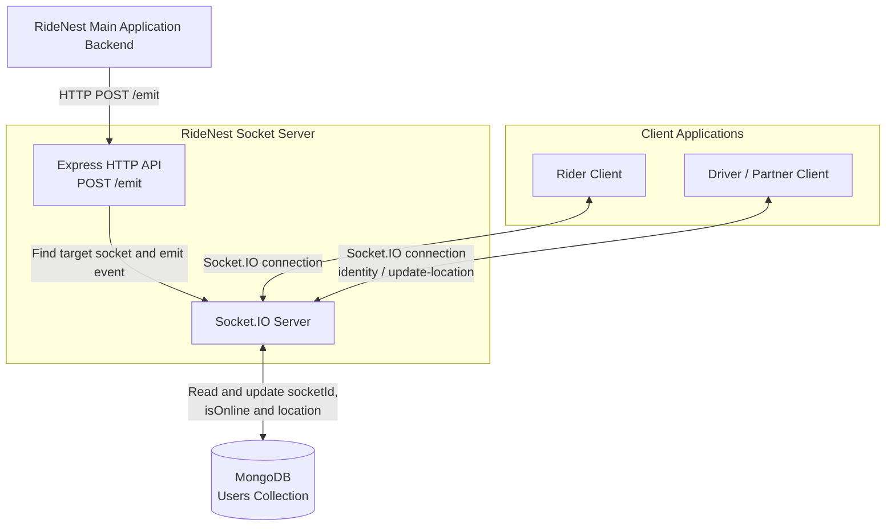
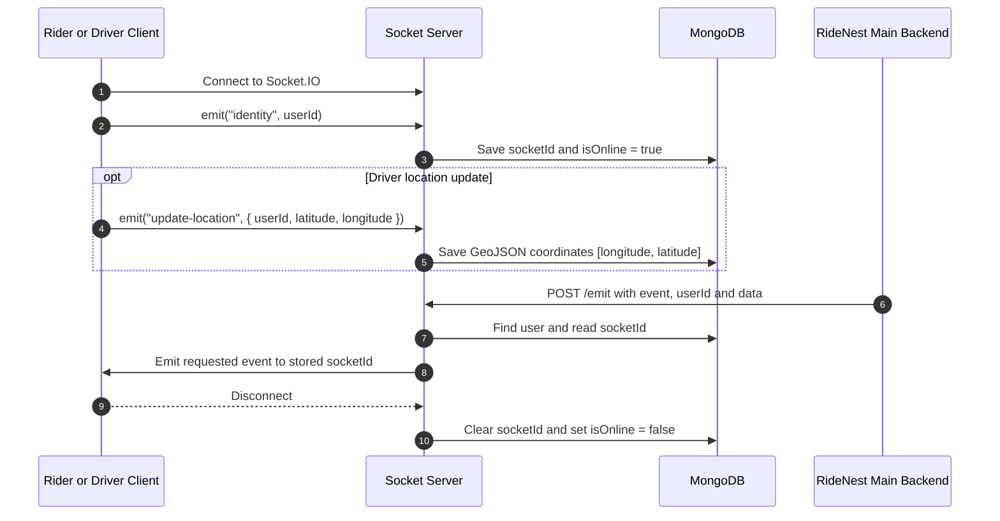

# RideNest Socket Server

A dedicated Node.js and Socket.IO service for **RideNest**, a multi-vendor vehicle booking platform. It manages real-time client connections, online presence, driver location updates, and targeted event delivery from the main application backend.

> **Project status:** In development. This service currently provides connection tracking, location persistence, and an HTTP-to-Socket.IO event bridge. Authentication, authorization, multi-device connection handling, and distributed scaling are not yet implemented.

---

## Table of Contents

- [Overview](#overview)
- [Architecture](#architecture)
- [Features](#features)
- [How It Works](#how-it-works)
- [Socket Events](#socket-events)
- [HTTP API](#http-api)
- [Database Schema and Geospatial Index](#database-schema-and-geospatial-index)
- [Tech Stack](#tech-stack)
- [Project Structure](#project-structure)
- [Getting Started](#getting-started)
- [Client Integration Example](#client-integration-example)
- [Security and Current Limitations](#security-and-current-limitations)
- [Planned Improvements](#planned-improvements)

---

## Overview

The Socket Server runs separately from RideNest's main application backend. This keeps persistent real-time connections and socket event delivery in a dedicated service rather than coupling them directly to the core application API.

The service currently supports:

- Registering a connected socket against a user ID.
- Updating a user's online status when they connect or disconnect.
- Receiving and storing user location updates as GeoJSON.
- Sending an event to a user's currently stored socket connection through an HTTP endpoint.

The main application backend can call the HTTP endpoint to ask the Socket Server to deliver an event to a connected client.

## Architecture

The following diagram shows the current service structure and an example of how the main application backend can use it. Booking event names in this diagram are examples of application-level events; they are not booking workflows implemented by this repository.



### Example event delivery flow



## Features

### 1. Socket connection and identity mapping

- Accepts Socket.IO client connections.
- Listens for the `identity` event containing a user ID.
- Associates the supplied user ID with the active socket using `socket.userId`.
- Stores the socket ID in MongoDB and marks the user as online.

**Note:** The current `identity` event associates a client-supplied user ID with a socket. It does not authenticate or verify that identity.

### 2. Live location updates

- Listens for the `update-location` event.
- Stores latitude and longitude in the user's MongoDB document.
- Uses GeoJSON Point format with coordinates ordered as `[longitude, latitude]`.

### 3. Online presence and disconnect handling

- Sets `isOnline` to `true` when a user registers their socket identity.
- Listens for Socket.IO's built-in `disconnect` lifecycle event.
- Clears the stored `socketId` and sets `isOnline` to `false` when the associated socket disconnects.

### 4. HTTP-to-Socket.IO event bridge

- Exposes `POST /emit` for the main backend or another server-side service.
- Looks up the target user's stored socket ID.
- If a socket ID is present, emits the supplied event and payload to that socket.

This lets the main backend trigger real-time client updates without maintaining the client's Socket.IO connection itself.

### 5. MongoDB geospatial index

- Defines a `2dsphere` index on the `location` field.
- Prepares the user location data for future geospatial queries, such as nearby-driver discovery.

**The repository currently defines the index but does not implement a nearby-driver search query.**

## How It Works

1. A client connects to the Socket Server using Socket.IO.
2. The client emits `identity` with its user ID.
3. The server stores the socket ID and marks the user as online.
4. A driver or partner client can emit `update-location` to save its latest coordinates.
5. The RideNest main backend can call `POST /emit` with a target user ID, event name, and data.
6. The Socket Server looks up the user's stored socket ID and emits the event if a socket ID is available.
7. When the socket disconnects, the server clears the stored socket ID and marks the user offline.

## Socket Events

### Client to server

| Event             | Payload                           | Current behavior                                                                                                                                |
| ----------------- | --------------------------------- | ----------------------------------------------------------------------------------------------------------------------------------------------- |
| `identity`        | `userId` (string)                 | Associates the supplied user ID with the socket, saves `socketId`, and sets `isOnline` to `true`.                                               |
| `update-location` | `{ userId, latitude, longitude }` | Updates the user's GeoJSON location in MongoDB.                                                                                                 |
| `disconnect`      | Socket.IO lifecycle event         | Clears the associated user's `socketId` and sets `isOnline` to `false`. This is handled by the server; clients do not need to emit it manually. |

### Server to client

The `POST /emit` endpoint accepts an event name and payload, then forwards them to the target socket. The server does not currently define a fixed list of outgoing event handlers.

The following are examples of application-level event names that a RideNest client could listen for, provided the main backend sends them through `/emit`:

| Example event    | Possible recipient | Example purpose                                  |
| ---------------- | ------------------ | ------------------------------------------------ |
| `new-booking`    | Driver / Partner   | Notify a driver about a ride request.            |
| `accept-booking` | Rider              | Notify a rider that a driver accepted a request. |
| `reject-booking` | Rider              | Notify a rider that a driver declined a request. |

These are integration examples, not booking business logic implemented in this repository.

## HTTP API

### `POST /emit`

Sends a Socket.IO event to the user identified by `userId`, if the user has a stored socket ID.

**Request headers**

```http
Content-Type: application/json
```

**Request body**

```json
{
  "event": "new-booking",
  "userId": "673b1e9c20a1f0b48a000101",
  "data": {
    "bookingId": "673b22b10a1f0b48a000102",
    "fare": 250,
    "pickupAddress": "Connaught Place, New Delhi",
    "dropAddress": "IGI Airport Terminal 3"
  }
}
```

**Current response behavior**

| Situation                                           | Current response                                                 |
| --------------------------------------------------- | ---------------------------------------------------------------- |
| User exists and has a stored `socketId`             | `{ "success": true }` after calling `io.to(socketId).emit(...)`. |
| User exists but has no stored `socketId`            | `{ "success": true }`; no socket event is emitted.               |
| User is not found, or a database/query error occurs | `{ "success": false }` from the catch block.                     |

The endpoint currently returns JSON responses without setting distinct HTTP error status codes for these cases. A successful response does not confirm that the recipient's client received or processed the event.

## Database Schema and Geospatial Index

The service imports the `User` Mongoose model and updates fields on the existing users collection.

| Field      | Type           | Purpose in this service                                                  |
| ---------- | -------------- | ------------------------------------------------------------------------ |
| `socketId` | `String`       | Stores the socket ID currently associated with the user.                 |
| `isOnline` | `Boolean`      | Tracks the online status set by socket identity and disconnect handlers. |
| `location` | GeoJSON object | Stores the user's location as a Point.                                   |

Location format:

```javascript
{
  type: "Point",
  coordinates: [longitude, latitude]
}
```

The model defines these indexes:

```javascript
userSchema.index({ location: "2dsphere" });
userSchema.index({ isOnline: true });
```

The geospatial index prepares the collection for location-based queries. A query to find nearby drivers is not part of the current implementation.

## Tech Stack

- **Runtime:** Node.js (ES Modules)
- **Web framework:** Express.js
- **Real-time communication:** Socket.IO
- **Database:** MongoDB
- **ODM:** Mongoose
- **Environment variables:** dotenv
- **Development tool:** Nodemon

## Project Structure

```text
ridenest-socketServer/
├── models/
│   └── user.model.js
├── .env
├── .gitignore
├── index.js
├── package.json
└── README.md
```

## Getting Started

### Prerequisites

- Node.js 18 or later
- npm
- MongoDB Atlas connection string or a reachable MongoDB instance

### 1. Clone the repository

```bash
git clone https://github.com/Pratik-Tiruwa/ridenest-socketServer.git
cd ridenest-socketServer
```

### 2. Install dependencies

```bash
npm install
```

### 3. Configure environment variables

Create a `.env` file in the project root:

```env
PORT=8000
MONGODB_URL=mongodb+srv://<username>:<password>@<cluster-url>/ridenest?retryWrites=true&w=majority
NEXT_BASE_URL=http://localhost:3000
```

| Variable        | Description                                                                     |
| --------------- | ------------------------------------------------------------------------------- |
| `PORT`          | Port used by the HTTP and Socket.IO server. Defaults to `6000` if not provided. |
| `MONGODB_URL`   | MongoDB connection string.                                                      |
| `NEXT_BASE_URL` | Origin allowed by the Socket.IO CORS configuration.                             |

Keep your real database credentials in `.env`. Do not commit secrets to the repository.

### 4. Start the development server

```bash
npm run dev
```

With `PORT=8000`, the server listens on port `8000`. If `PORT` is not set, it defaults to `6000`.

The current startup code logs the server start message and attempts the MongoDB connection. Check the terminal output to confirm that the database connection succeeds.

## Client Integration Example

Install the Socket.IO client in the client application:

```bash
npm install socket.io-client
```

Connect to the Socket Server:

```javascript
import { io } from "socket.io-client";

const socket = io("http://localhost:8000");

// Register the current user's ID with the socket connection.
// This is identity association, not secure authentication.
socket.emit("identity", currentUserId);

// Example: send a driver's current location.
socket.emit("update-location", {
  userId: currentUserId,
  latitude: 28.6139,
  longitude: 77.209,
});

// Listen for an application event sent through POST /emit.
socket.on("new-booking", (data) => {
  console.log("New booking received:", data);
});
```

Replace `currentUserId` with the logged-in user's MongoDB ID and use the configured Socket Server URL for the relevant environment.

## Security and Current Limitations

This service is an active development project. The following items should be addressed before production use:

- **Socket identity is not verified:** The `identity` event currently trusts the user ID supplied by the client. Add JWT or another trusted authentication mechanism and derive the user ID from the verified identity.
- **The `/emit` endpoint is not protected:** Add service-to-service authentication so arbitrary clients cannot trigger events for users.
- **Event names and payloads are not restricted:** Validate incoming request bodies and allow only approved event names and payload shapes.
- **Location updates are not authorized or validated:** Validate coordinate ranges and associate updates with the authenticated socket user rather than trusting a client-supplied user ID.
- **One socket ID per user:** A new connection can overwrite an existing socket ID. Multiple tabs or devices are not handled reliably yet.
- **Database startup and error handling need improvement:** Ensure the database is connected before accepting requests, and handle/log connection and socket-handler errors explicitly.
- **Delivery acknowledgement is not implemented:** The HTTP response indicates that the server attempted to emit an event; it does not confirm client receipt or processing.

## Planned Improvements

- Add JWT-based Socket.IO authentication.
- Protect the internal event dispatch endpoint.
- Validate event names, payloads, and location coordinates.
- Support multiple active connections per user.
- Improve database connection lifecycle, logging, and error handling.
- Add nearby-driver discovery using MongoDB geospatial queries.
- Add Redis Socket.IO adapter support if the service is deployed across multiple instances.
- Expand API and event documentation with integration tests.
